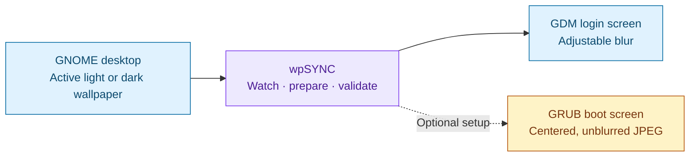
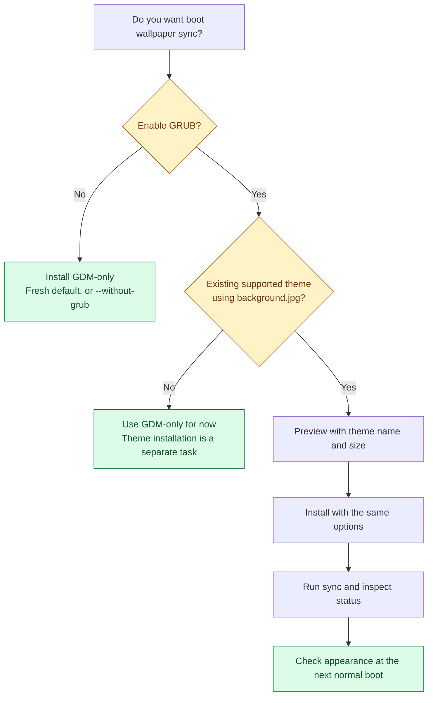
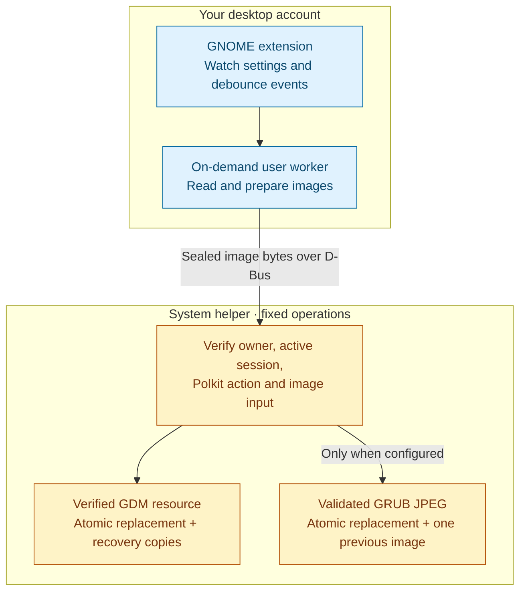

<div align="center">

# wpSYNC

**One wallpaper. Your desktop, login screen, and optional boot screen.**

Fedora 44 · GNOME 50 · Wayland · MIT licensed

[Install](#installation) · [Risks](#risks-and-safeguards) · [Optional GRUB](#optional-grub-setup) · [Recover](#pause-restore-or-uninstall) · [Troubleshoot](#troubleshooting)

</div>

wpSYNC follows your GNOME wallpaper and prepares it for the **GDM login screen**
and, when explicitly configured, your **existing GRUB theme**. Choose an image in
GNOME Settings or use **Set as Background** in Files; the same watcher coordinates
both destinations. The original image stays unchanged.



| Desktop | Login | Boot |
|---|---|---|
| GNOME keeps its own image and scaling preference. | GDM uses a prepared image with adjustable blur; default **12**, range **0–30**. | Optional GRUB output uses your configured dimensions and preserves the theme's layout. |
| Changes when you select a wallpaper. | Visible when a **new GDM greeter** starts. | Visible at the **next normal boot**. |

> [!IMPORTANT]
> This installs a privileged system helper and modifies a system-wide GDM theme
> resource. Optional GRUB support also writes wallpaper files under `/boot`.
> Read the risks below before installing. **Extension activation can synchronize
> your current wallpaper automatically**, including on the next login if GNOME
> cannot activate it immediately.

## Before you install

The first release supports the following environment:

| Requirement | Supported scope |
|---|---|
| Operating system | Conventional **Fedora 44 Workstation** installation |
| Desktop | **GNOME Shell 50**, using **Wayland** |
| Account | One configured owner, logged into an active local graphical session on **seat0** |
| Administration | Ability to authenticate with `sudo` for installation and removal |
| Source images | Local JPEG, PNG, WebP, AVIF, JPEG XL, BMP or TIFF, subject to installed decoders |
| Optional GRUB | An already installed, root-owned static theme under `/boot/grub2/themes/`, using `background.jpg` |

Other distributions, GNOME versions, immutable Fedora variants such as
Silverblue, multiple wallpaper owners and multi-seat setups are outside this
release's supported scope. GDM's wallpaper is system-wide: different accounts
cannot each own a separate login image through this installation.

Check your environment from a terminal in your desktop session:

```sh
cat /etc/fedora-release
gnome-shell --version
printf 'Session type: %s\n' "$XDG_SESSION_TYPE"
```

Expect Fedora **44**, GNOME Shell **50.x** and session type **wayland**. These
commands are informational; the installer separately checks Fedora and GNOME
versions. Do not treat a successful file preview as a full compatibility test.

Before continuing, save your work, choose an image you are comfortable showing
before login, and let any package or theme installation finish. Keep your source
images and any personally customized theme backed up separately. wpSYNC's
recovery copies are not a substitute for a system backup.

## Risks and safeguards

> [!WARNING]
> **A wallpaper selected from a private folder can become a public-facing image.**
> People at your computer may see it before login or at boot, and the generated
> system files are not protected by the original image's permissions. GDM blur
> is a visual effect, not a privacy control. GRUB output is unblurred.

| Possible danger | What can happen | Safeguard and your next step |
|---|---|---|
| **GDM theme failure** | A bad resource, software defect or conflicting modification could affect the login screen, potentially requiring text-console recovery. | wpSYNC validates rebuilt resources and keeps verified Fedora originals. Know the [recovery procedure](docs/RECOVERY.md) before relying on it. |
| **GRUB appearance failure** | An unsuitable wallpaper can make menu text hard to read; image or theme incompatibility can produce incorrect rendering. | Check contrast with your existing theme. wpSYNC validates baseline JPEG output and keeps one previous image. Inspect the result on a normal boot after successful status checks. |
| **Private images and metadata** | Derivatives, recovery copies and diagnostics can retain sensitive content. With GDM blur set to **0**, PNG/JPEG input can be embedded unchanged, including metadata. | Choose non-sensitive images. Review logs before sharing them. Disabling or uninstalling does not erase every stored copy. |
| **Administrator trust** | The installer executes code with `sudo`; a modified or malicious source package could exceed wpSYNC's intended scope. | Obtain source from a trusted location and review the file plan and code. A checksum detects changed bytes only when its expected value is trusted. |
| **Account-level authorization** | While the owner has an active local session, any process running as that account can request the helper's narrow wallpaper operations without a separate password prompt. | This includes a same-account SSH process. It is not authorization restricted to the GNOME extension itself. Protect the configured account. |
| **Package or theme updates** | Another installer can overwrite the resource/background or race with a synchronization operation. | Avoid simultaneous operations. Re-run synchronization after updates finish. Unknown GDM modifications are refused; investigate rather than removing the checks. |
| **Partial installation or sync** | Dependencies, system files and user setup are separate phases. A later failure does not undo the entire installation. GDM can succeed while GRUB fails, or vice versa. | Read the error and inspect status before retrying. Partial user setup may need guided cleanup; rerunning is not guaranteed to fix it. The root file-install phase has rollback, but there is no transaction covering every phase. |
| **Disk space, power loss or processing limits** | Large images may need substantial scratch space; interrupted writes or resource limits can cause failures. | Processing is bounded and live images use atomic replacement. Those protections reduce risk; they do not guarantee recovery from every filesystem or power failure. Keep free space and inspect status after an interruption. |
| **Limited rollback history** | Each successful GRUB change replaces the single previous-image slot. | Restore before another update if you need that previous image. Keep separate copies of images you want to retain permanently. |

**Scope of boot changes:** optional GRUB synchronization replaces the configured
`background.jpg`, maintains `background.previous.jpg`, and uses temporary sibling
files during replacement. It preserves the theme's `theme.txt`, fonts, scrims,
icons and selection graphics. It does not regenerate `grub.cfg`, change
`/etc/default/grub`, alter EFI variables, kernels, initramfs, partitions or disk
encryption. These are implementation boundaries, not a claim of zero risk.

## Installation

Run installation as your **normal desktop user**, from a local graphical
session. Do **not** prefix `./install.sh` with `sudo`; the installer elevates only
its system phase. Use Fedora's system Python, not a pip virtual environment.

### 1. Get the source

Use a trusted clone, extracted repository ZIP, or packaged source release.
For the **0.1.0 release archive**, put the archive and its checksum file in the
same directory, then run:

```sh
sha256sum --check wpSYNC-0.1.0.tar.gz.sha256
tar -xzf wpSYNC-0.1.0.tar.gz
cd wpSYNC-0.1.0
```

The checksum check should report `wpSYNC-0.1.0.tar.gz: OK`. Stop if it fails.
For another release, substitute that release's version in the filenames. If you
already cloned or extracted the repository, open a terminal in the directory
containing `install.sh` and `README.md` instead.

### 2. Preview the installation

```sh
./install.sh --help
./install.sh --plan
```

The plan lists the system/user destinations and the selected synchronization
targets. It does not install packages or services or change wallpaper files.
It is a file preview, not a dependency or live-theme acceptance check.

On a **fresh installation**, GRUB is disabled. On an **upgrade**, omitting GRUB
options preserves the existing configuration. To explicitly request GDM-only
operation, use `--without-grub` for both preview and installation; see
[updates](#updates) if GRUB is already configured.

### 3. Install

For the default fresh GDM-only installation:

```sh
./install.sh
```

The installer:

1. Checks supported Fedora/GNOME versions and missing RPM packages.
2. Offers to install missing dependencies, then validates the schema and runs tests.
3. Requests installation confirmation and uses `sudo` for system files.
4. Installs the user worker, extension, Files integration and CLI.
5. Enables the extension now, or queues activation for the next login.
6. Offers to close Nautilus windows so its menu provider can load.

Save any ongoing Files operations before accepting a Nautilus restart. The
installer does not restart GDM, log you out or reboot. Automatic synchronization
can begin as soon as the extension is active.

<details>
<summary><strong>Dependencies and unattended options</strong></summary>

Dependencies are Fedora RPMs: GNOME/GDM/GJS, Nautilus and its Python provider,
Python/PyGObject/Pillow, GTK/libadwaita, image loaders, ImageMagick, GLib development
tools, Polkit, SELinux tools, D-Bus and systemd. The authoritative list is
[`PACKAGES` in tools/install.py](tools/install.py).

| Option | Meaning |
|---|---|
| `--plan` | Print the selected file/target plan and exit. |
| `--install-deps` | Authorize installing missing Fedora packages through `sudo dnf`. |
| `--yes` | Skip ordinary confirmation prompts; do not restart Nautilus. `sudo` may still ask for authentication. |
| `--without-grub` | Disable privileged GRUB support and its user preference during installation or upgrade. Does not restore the old image. |
| `--grub-theme NAME --grub-size WIDTHxHEIGHT` | Configure and enable an existing supported GRUB theme; both options are required. |

For unattended confirmation, after reviewing the plan:

```sh
./install.sh --yes --install-deps
```

`--yes` alone **does not authorize installing missing packages**. If packages
are missing, it exits with an explanation unless `--install-deps` is supplied.
The explicit dependency option can install packages before the final application
installation confirmation.

</details>

### 4. Activate and verify

If GNOME has not discovered the extension, save your work and log out/in when
convenient. Restart Nautilus when ready to load its menu integration. Then run:

```sh
gnome-extensions info wallpaper-sync@mouge
gnome-extensions prefs wallpaper-sync@mouge
wallpaper-sync --version
wallpaper-sync sync
wallpaper-sync status
```

Keep **Synchronize wallpapers** on. **Follow current desktop wallpaper** enables
automatic following; turn that off if you prefer to use **Sync Now** manually.
The master switch must remain on for manual synchronization too.

For a successful check, `sync` should finish without an error, and `status`
should report the selected source and the latest backend state. A disabled GRUB
backend is expected on a fresh GDM-only installation. If an error is reported,
read the backend details: one destination may already have succeeded.

### 5. Inspect the appearance

| Check | When and what to inspect |
|---|---|
| Desktop | Select a non-sensitive image in GNOME Settings and confirm the correct light/dark source. |
| GDM | Inspect a newly started login greeter during a deliberate logout/reboot. A greeter already in memory can keep the old image. The GNOME session lock screen is separate. |
| GRUB, if configured | After successful processing/status checks, inspect the wallpaper and menu readability at the next normal boot. |

No immediate reboot is needed to install or validate generated files. Passing
unit tests or seeing a matching checksum does not establish that your firmware,
GRUB theme or GDM greeter has rendered the result correctly.

## Optional GRUB setup

Choose this only if you already have a working GRUB theme that uses a static
`background.jpg` under `/boot/grub2/themes/<theme>/`. wpSYNC does not install,
select or redesign a theme. Confirm the theme's `theme.txt` references that file;
its existing wallpaper must pass the helper's JPEG and trusted-path checks.
The theme must already be selected in your boot setup. wpSYNC does not reveal
a hidden GRUB menu or change its display mode.



For an existing **Tela** theme at `/boot/grub2/themes/tela`, using an output size
of **2880 × 1800**:

```sh
./install.sh --plan --grub-theme tela --grub-size 2880x1800
./install.sh --grub-theme tela --grub-size 2880x1800
wallpaper-sync sync
wallpaper-sync status
```

Replace `tela` and the dimensions with your actual theme and desired output.
`--grub-theme` takes a directory **name**, not a path. Each dimension must be
64–8,192 pixels, with at most **8,294,400 total pixels**. The option sizes the
image; it does not change the firmware/GRUB display mode.

The derivative respects EXIF orientation, fills the chosen dimensions without
stretching, crops centrally, flattens transparency over black and removes
metadata. It is an 8-bit, non-progressive RGB JPEG, without GDM's blur. Important
content near an image's edges may be cropped.

| Example path | What happens there |
|---|---|
| `/boot/grub2/themes/tela/background.jpg` | Validated live wallpaper, replaced atomically. |
| `/boot/grub2/themes/tela/background.previous.jpg` | One prior validated wallpaper for rollback. |
| `/boot/grub2/themes/tela/theme.txt`, fonts, icons, scrims | Preserved; not regenerated by synchronization. |
| `/etc/wallpaper-sync/owner.json` | Root-owned owner, theme and output-size configuration. |

Both the root configuration and **Sync GRUB boot wallpaper** preference must
allow synchronization. `wallpaper-sync grub-enable` resumes an already configured
backend; it cannot authorize a new theme or destination. See the
[GRUB guide](docs/GRUB_SYNC.md) for processing and transaction details.

## Everyday controls

Open preferences with `gnome-extensions prefs wallpaper-sync@mouge`.
Fresh defaults are master sync **on**, automatic following **on**, source
**active light/dark**, GDM blur **12**, conversion **on**, notifications **off**,
and GRUB **off unless configured during installation**.

| Command or control | Effect |
|---|---|
| `wallpaper-sync status` | Inspect current source, backend state and last result. |
| `wallpaper-sync doctor` | Collect detailed local diagnostics. Review before sharing. |
| `wallpaper-sync sync` | Request synchronization and wait for the result. Requires the master switch. |
| `wallpaper-sync set '/path/to/an image.webp'` | Set **both** GNOME light and dark wallpaper URIs to this image. The active extension handles following. |
| **Follow current desktop wallpaper** off | Stop automatic following; manual Sync Now remains available. |
| **Synchronize wallpapers** off | Pause both backends, including manual sync. Existing wallpapers remain installed. |
| `wallpaper-sync grub-disable` | Pause GRUB only; keep the existing boot wallpaper. |
| `wallpaper-sync grub-enable` | Resume configured GRUB and request sync if the master switch is on. |

Local input is limited to **64 MiB**, **16,384 pixels per side** and **64
megapixels**. TIFF uses its first frame. Remote URLs, slideshow schedules and
SVG wallpapers are unsupported. Decoder availability determines whether each
listed raster format can be read.

## Pause, restore, or uninstall

**Pausing does not restore or delete an image.** It prevents new work and cancels
stale user-side preparation. A request already executing in the privileged
helper may still finish and install its image. Use the action that matches your
intention:

| Intention | Action | Result |
|---|---|---|
| Freeze both installed images | Turn **Synchronize wallpapers** off in preferences. | No new sync work; installed images remain and an in-flight helper request may still finish. |
| Freeze only the boot image | `wallpaper-sync grub-disable` | GRUB pauses; GDM can continue. |
| Restore Fedora's GDM appearance | `wallpaper-sync restore` | Master sync is turned off first, pausing **both** backends; GDM is restored, GRUB's image is unchanged. |
| Restore the previous GRUB image | `wallpaper-sync restore-grub` | GRUB sync is turned off first and the one previous image is restored; the GDM setting/image is unchanged. |
| Remove wpSYNC | `./uninstall.sh` from the source tree. | Offers GDM restoration, then removes tracked application files. GRUB restoration is a separate step. |

GDM restoration uses the **verified original for the currently installed Fedora
GNOME package**, not necessarily your pre-install custom theme. GDM recovery
copies are created during GDM operations, not merely by completing installation.

GRUB restoration validates both the live and previous image; a damaged live
image can prevent CLI restoration even when a backup exists. There may be no
previous image before the first successful change. The corresponding
synchronization switch remains off if restoration fails. Turning a switch off
cannot undo an operation that already committed.

If you want to remove wpSYNC and also undo its most recent GRUB change, restore
GRUB **before** removing the helper or disabling its installation configuration:

```sh
# Only if GRUB is configured and you want its previous image back:
wallpaper-sync restore-grub

# Then remove the application; accept GDM restoration if desired:
./uninstall.sh
```

Uninstallation preserves source images, desktop wallpaper settings, recovery
backups, and user cache/status. Dependency RPMs are not automatically removed.
Those retained files can contain earlier wallpapers and source paths. Keep
recovery copies until the system's appearance is verified; consult the
[recovery guide](docs/RECOVERY.md) before deleting them.

> [!CAUTION]
> If GDM cannot start or the helper is unavailable, normal CLI restoration may
> not be usable: the helper requires the owner's active local graphical session.
> Follow the [text-console recovery guidance](docs/RECOVERY.md#gdm-restoration).
> A backup must match the currently installed GNOME package; do not blindly copy
> an old resource or restart GDM while a session contains unsaved work.

## Updates

Obtain the new trusted source, then run these as the **same owner**:

```sh
./install.sh --plan
./install.sh
```

Existing preferences and configured GRUB settings are preserved when their
options are omitted. A recognized earlier Tela-enabled installation migrates
with its 2880 × 1800 profile; an older GDM-only installation stays GDM-only.

To remove GRUB support during an update, first run `wallpaper-sync restore-grub`
if you want the previous boot image back, then:

```sh
./install.sh --plan --without-grub
./install.sh --without-grub
```

After a **Fedora/GNOME package update** or separate **GRUB theme installation**,
wait for that operation to finish, then run `wallpaper-sync sync` and inspect
status. There is no package-manager or theme-directory hook. A new GNOME package
requires its matching original resource; unexpected modifications or a missing
verified baseline cause a refusal. A Fedora/GNOME major-version upgrade can also
move you outside this release's supported scope.

## Troubleshooting

Start with inspection commands:

```sh
wallpaper-sync status
wallpaper-sync doctor
gnome-extensions info wallpaper-sync@mouge
journalctl --user -u wallpaper-sync.service -n 50 --no-pager
journalctl -u wallpaper-sync-helper.service -n 50 --no-pager
```

System journal access may require administrator privileges. **Redact usernames,
private image paths, URIs and other sensitive details before posting output.**

| Symptom | Check or next step |
|---|---|
| Extension is missing immediately after installation | Save your work and log out/in so GNOME can discover it. |
| Files has no wallpaper menu entry | Restart Nautilus when no file operation needs its windows; check the `nautilus-python` dependency. |
| Manual sync says synchronization is disabled | Enable **Synchronize wallpapers**; automatic following can stay off. |
| Desktop changes but other images do not | Check extension activation, master/automatic switches, source selection and backend errors. |
| GDM still shows the old wallpaper after successful sync | Inspect a newly started greeter. Locking the current session is not an equivalent check. |
| GRUB says it is not configured | Re-run installation with both GRUB options; the preferences switch alone is insufficient. |
| Authorization fails | Use the configured owner's active local graphical session on seat0. Do not broaden Polkit or make `/boot` user-writable. |
| Unknown GDM modification / no verified Fedora original | Stop competing theme tools and inspect the [recovery guide](docs/RECOVERY.md). Do not delete state or bypass checks to force an overwrite. |
| Missing, oversized or unsupported image | Select a supported local raster image within the limits; check installed decoders and conversion settings. |
| A service is inactive while idle | Both workers activate on demand and exit when idle; this alone is expected. |
| Failure after a write or interrupted installation | Inspect actual state before retrying. Valid image bytes may already be installed even if a later state/durability step failed. |

Do not run GRUB generators/installers, rebuild an initramfs, disable SELinux,
or restart GDM as generic wallpaper troubleshooting steps.

## What gets installed and why root is involved



The extension and image preparation run as your user. The root helper accepts
narrow apply/restore operations, not arbitrary copy destinations or shell
commands. GRUB pixel decoding in the helper runs in a bounded child as `nobody`.
Systemd limits writable locations; SELinux remains enabled. Account and session
checks apply in addition to Polkit. See the full [security model](docs/SECURITY.md)
for the exact boundary and remaining races with external tools.

| Location | Purpose |
|---|---|
| `/usr/local/bin/wallpaper-sync` | CLI |
| `/usr/local/lib/wallpaper-sync/` | Installed code, documentation and notices |
| `/usr/local/libexec/wallpaper-sync-helper` | Privileged helper entry point |
| `/etc/wallpaper-sync/owner.json` | Authorized owner and optional GRUB profile |
| `/etc/systemd/system/wallpaper-sync-helper.service` | On-demand system service and sandbox |
| `/etc/polkit-1/rules.d/49-wallpaper-sync.rules` | Narrow authorization for the installing account |
| `/usr/share/gnome-shell/gnome-shell-theme.gresource` | GDM resource modified by synchronization |
| `/var/lib/wallpaper-sync/` | Root-only state, installation manifest and recovery copies |
| `~/.local/share/gnome-shell/extensions/wallpaper-sync@mouge/` | GNOME extension |
| `~/.local/share/nautilus-python/extensions/wallpaper_sync.py` | Files integration |
| `~/.config/systemd/user/wallpaper-sync.service` | On-demand user service |
| `~/.cache/wallpaper-sync/` and `~/.local/state/wallpaper-sync/` | Prepared images and local status |

The `~` paths above are XDG defaults. Custom XDG directories are respected;
`--plan` prints resolved paths, including D-Bus and policy files. wpSYNC has no
telemetry or remote wallpaper service. Runtime operation is local; installing
missing packages may contact configured Fedora repositories.

The executable remains `wallpaper-sync`, and the extension UUID/D-Bus identifiers
retain their original `wallpaper-sync`/`mouge` namespace for compatibility. These
identifiers do not hard-code your login name; the installer records the actual
installing account.

## Development and further reading

```sh
make check
make dist
```

Run checks as a normal user. Besides the runtime dependencies, development
checks require `make` and Node.js for JavaScript syntax validation. Tests use
isolated resources and memory-only settings; they do not install services or
change your wallpaper. A passing suite is not proof of live greeter/boot
rendering. Follow the [acceptance plan](docs/TEST_PLAN.md) for those checks.

`make dist` produces the allowlisted source archive and SHA-256 file in `dist/`.
GitHub workflows provide Fedora checks and a draft-release build on matching
version tags; their presence is not evidence of a successful hosted run.

| Guide | Details |
|---|---|
| [Installation](docs/INSTALLATION.md) | Dependencies, file inventory and upgrade behavior |
| [GRUB synchronization](docs/GRUB_SYNC.md) | Theme requirements, image preparation and rollback |
| [Recovery](docs/RECOVERY.md) | Verified backups, manual recovery and retained state |
| [Security model](docs/SECURITY.md) | Privilege boundary, sandboxing and local data |
| [Testing](docs/TEST_PLAN.md) | Isolated checks and live acceptance procedure |
| [Contributing](CONTRIBUTING.md) | Development workflow |
| [Security reporting](SECURITY.md) | Reporting vulnerabilities |
| [Changelog](CHANGELOG.md) · [Releasing](docs/RELEASING.md) | Version history and publishing procedure |

Diagrams use [Mermaid fences supported by GitHub](https://docs.github.com/en/get-started/writing-on-github/working-with-advanced-formatting/creating-diagrams).
A local Markdown viewer without Mermaid support may show their source instead.

## License and attribution

wpSYNC is [MIT licensed](LICENSE). Its GDM resource/CSS mechanism derives from
[kem-a/gnome-gdm-wallpaper](https://github.com/kem-a/gnome-gdm-wallpaper).
Upstream notices are preserved in [THIRD_PARTY_LICENSES.md](THIRD_PARTY_LICENSES.md)
and [licenses/gnome-gdm-wallpaper-MIT.txt](licenses/gnome-gdm-wallpaper-MIT.txt).
